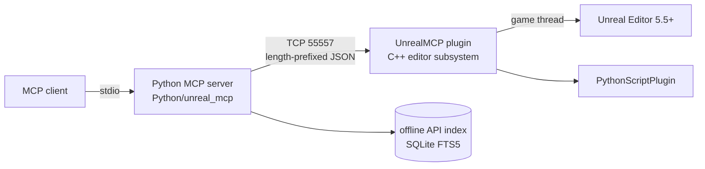

<p align="center">
  
</p>

<h1 align="center">UnrealMCP: local agent bridge for Unreal Engine</h1>

<p align="center">
  Drive a live Unreal Editor from any MCP client (Claude Code, Cursor, Windsurf, VS Code, Cline, local LLMs).<br/>
  Runs on your machine. No account, no API key, no hosted service.
</p>

<p align="center">
  <a href="https://www.unrealengine.com/"></a>
  
</p>

> Fork of [flopperam/unreal-engine-mcp](https://github.com/flopperam/unreal-engine-mcp) (MIT). Flopperam's own
> development has moved to a hosted product. This fork continues the open, local edition and is not affiliated
> with Flopperam or Aura.

## What it can do

| Layer | Tools |
|---|---|
| **Universal** | `execute_python`: run any Unreal Python in the editor and get back the result, stdout and traceback |
| **Reflection** | `object_describe`, `property_get`, `property_set`, `function_call`: read or write any UPROPERTY and call any UFUNCTION on any object or actor (undoable) |
| **Observation** | `viewport_capture` (returns an image the model can see), `editor_log` (Output Log tail with filters and a cursor), `console_command` |
| **Editor** | `unreal_status`, `project_context`, `editor_action` (undo/redo, save all, open asset, load level, select, focus, PIE start/stop) |
| **API knowledge (offline)** | `unreal_api_search`, `unreal_api_doc`, `unreal_api_build_index`: full-text index of the whole `unreal` Python API, built from your engine's own stub |
| **Scene & level** | `scene_brief`, `scene_query` (class/label/tag/folder/sphere/box), `actor_inspect`, `scene_compose` (batched spawn/modify/delete with grid/circle/line patterns, one undo step), `level_inspect`, `scene_assert` (verify the level and assets against assertions) |
| **Assets** | `search_assets`, `asset_references` (dependencies/referencers, transitive), `asset_manage` (duplicate/rename/delete/save/folders/properties), `asset_import` (FBX/glTF/OBJ/textures/audio, from the editor's disk or uploaded from the MCP machine) |
| **3D modeling (Blender)** | `blender_run` (headless Blender on the MCP machine: bpy + helpers for primitives, bevels, materials, UVs, pivots, FBX/GLB export, preview render returned as an image, then auto-import into Unreal), `blender_status` |
| **Materials** | `material_inspect`, `material_edit` (build a whole expression graph in one call), `material_instance` |
| **VFX, cinematics, data** | `niagara_edit` (place systems, set User parameters), `sequence_edit` (Level Sequences: cameras, bindings, transform keys, camera cuts), `data_table` (read / write rows) |
| **Blueprints, UI, AI** | `bp_export` / `bp_apply` (whole Blueprints as a JSON graph spec: variables, components, functions, nodes, pins and links, applied atomically and compiled with structured errors; dry run), `widget_export` / `widget_apply` (UMG widget trees with canvas anchors and slots), `bt_export` / `bt_build` (Blackboard keys and Behavior Trees from one nested spec) |
| **Gameplay & code** | `enhanced_input` (actions + mapping contexts with modifiers), `game_setup` (level/project game mode, default maps), `cpp_source` (read/write project C++, sandboxed to Source/Plugins/Config), `live_coding_compile` (compile and get parsed errors back), `performance_audit`, `package_project` / `package_status` (background UAT BuildCookRun to a standalone build) |
| **Runtime verification** | `pie_test`: play the level in PIE, drive it with real key / Enhanced Input action presses, holds, axes and mouse look, measure frame/game/GPU times, then assert on actors, properties, distances, Python expressions and the log (e.g. "no errors", "player health ≥ 100"). `pie_input` and `frame_stats` work in a running PIE session too |
| **Blueprint graphs** | `add_node` (23+ node types), `connect_nodes`, `delete_node`, `set_node_property`, `add_event_node`, `create_variable`, `set_blueprint_variable_properties`, `create_function`, `add_function_input/output`, `rename_function`, `delete_function` |
| **Blueprint assets** | `create_blueprint`, `add_component_to_blueprint`, `set_static_mesh_properties`, `set_physics_properties`, `compile_blueprint`, `read_blueprint_content`, `analyze_blueprint_graph`, `get_blueprint_variable_details`, `get_blueprint_function_details` |
| **Actors & materials** | `get_actors_in_level`, `find_actors_by_name`, `set_actor_transform`, `delete_actor`, `spawn_physics_blueprint_actor`, `get_available_materials`, `apply_material_to_actor/blueprint`, `set_mesh_material_color`, `get_actor_material_info` |
| **World building** | `create_town`, `create_castle_fortress`, `construct_house`, `construct_mansion`, `create_tower`, `create_maze`, `create_wall`, `create_staircase`, `create_arch`, `create_pyramid`, `create_suspension_bridge`, `create_aqueduct` |

Because `execute_python` and the reflection tools reach the whole editor API, an agent isn't limited to the dedicated
tools. Skills in [`skills/`](skills/) teach it the observe → act → verify loop and give it recipes for materials, scenes and Blueprints.

## Quick start

1. **Plugin**: open `FlopperamUnrealMCP/FlopperamUnrealMCP.uproject` (plugin preinstalled), or copy `UnrealMCP/` into
   `YourProject/Plugins/`. Also enable **Python Editor Script Plugin** (it's a declared dependency).
2. **Server**: `cd Python && uv run unreal_mcp_server_advanced.py`
3. **Client**: Claude Code:
   ```bash
   claude mcp add unreal -- uv --directory /path/to/unreal-engine-mcp/Python run unreal_mcp_server_advanced.py
   ```
   Cursor/others: see [`mcp.json`](mcp.json) and [LOCAL_SETUP.md](LOCAL_SETUP.md).
4. **Optional (recommended)**: build the offline API index. Turn on *Editor Preferences → Plugins → Python →
   Developer Mode*, restart the editor, then ask the agent to run `unreal_api_build_index`.

## Architecture



- Wire protocol: a 4-byte big-endian length followed by a UTF-8 JSON payload, on a persistent connection with request ids.
  Old unframed clients still work. See `Python/unreal_mcp/protocol.py`.
- Each command runs on the game thread with a timeout. Mutating commands are editor transactions, so they can be undone.
- Configuration is through environment variables on both sides: `UNREAL_MCP_PORT`, `UNREAL_MCP_TOKEN`, `UNREAL_MCP_BIND`
  (editor), `UNREAL_MCP_HOST` (server). See [LOCAL_SETUP.md](LOCAL_SETUP.md#remote-editor).

## Security

`execute_python` is arbitrary code execution inside your editor. The plugin binds to `127.0.0.1` by default and
refuses to bind to any other address unless `UNREAL_MCP_TOKEN` is set. Only connect MCP clients you trust.

## Development

```bash
cd Python && uv sync --group dev && uv run pytest && uv run ruff check .
```
The tests run against `tests/fake_unreal.py`, a fake of the plugin's wire protocol, so they don't need an engine.
Against a real editor: `uv run python ../scripts/smoke.py`. Build and test steps for Windows are in
[docs/WINDOWS_TEST.md](docs/WINDOWS_TEST.md). The plugin dev loop is `scripts/ue_linux.sh` or `scripts\ue_windows.ps1`: build, launch, quit and rebuild, per `UNREAL_MCP_PORT`. After editing the plugin, run `scripts/sync_plugin.sh` (or `.ps1`) to update the sample project's copy.

Roadmap: [docs/ROADMAP.md](docs/ROADMAP.md).

## License

MIT. See [LICENSE](LICENSE). Original work © Flopperam and contributors; fork modifications © Shaun Dolan.

## UE-Bench
20 scripted editor tasks with automatic checkers. They cover scene, assets, materials, cinematics, input, performance,
Blender modeling, Blueprints, UI, AI and PIE gameplay (a coin collected by walking into it, a guard walking its Behavior Tree route, and a full "prompt to playable" coin arena with score, HUD and a chasing enemy). Each checker is proven against a reference solution and against near-miss solutions. See [bench/README.md](bench/README.md).
