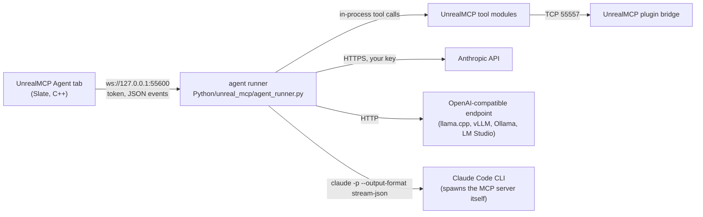

# UnrealMCP Agent panel

An in-editor chat agent, the local counterpart to Aura's in-editor agent. **Window → Tools → UnrealMCP Agent** opens a
dockable tab where you chat with an agent that drives the editor through the UnrealMCP tools. It shows every tool call,
asks before destructive calls, and can undo a whole agent turn. It is model-agnostic and local-first: you pick the
provider, and nothing goes through a service of ours.



## Set up

1. **Plugin:** the UnrealMCP plugin (0.3.0 or later, from this branch). The tab is part of the plugin, so there's
   nothing else to enable.
2. **uv** on the PATH of the editor process (`curl -LsSf https://astral.sh/uv/install.sh | sh`). The panel also looks in
   `~/.local/bin`, `~/.cargo/bin` and the Homebrew prefixes, because GUI launches often don't get the shell's PATH.
3. **Where the runner lives:** the panel looks for `Python/unreal_mcp/agent_runner.py` in up to five parent folders of
   the plugin and of the project, which covers the sample project and a plugin copied into a project inside a clone of
   this repo. Otherwise, set **Editor Preferences → Plugins → UnrealMCP Agent → Python Dir** to the repo's `Python/`
   folder (or set `UNREAL_MCP_PYTHON_DIR`). Until then, the panel shows how to configure it.
4. **A provider**, configured in the environment the editor (and so the runner) starts from:

| Provider | Setup | Default model |
|---|---|---|
| `anthropic` | `ANTHROPIC_API_KEY` (your own key; the runner reads it from the environment and never stores it), then `cd Python && uv sync --extra anthropic` | `claude-opus-5-5` (`UNREAL_MCP_ANTHROPIC_MODEL` overrides it) |
| `openai` | Any OpenAI-compatible `/v1/chat/completions` endpoint with tool calling. `UNREAL_MCP_OPENAI_BASE_URL` (default `http://127.0.0.1:8080/v1`, llama.cpp's `llama-server --jinja`), optional `UNREAL_MCP_OPENAI_API_KEY`, `UNREAL_MCP_OPENAI_MODEL`. `UNREAL_MCP_OPENAI_VISION=1` also sends viewport captures to vision models | whatever the server serves |
| `claude_code` | The `claude` CLI, logged in (subscription or key). The runner runs `claude -p` per turn with this repo's MCP server attached | the CLI's default |
| `mock` | Nothing. It replays a scripted conversation (`--mock-script file.json`), for demos and tests. It never calls a model | — |

The runner's `hello` message reports which providers are configured, and the panel shows the reason next to the status
line when the selected one isn't.

## Use

- **Start runner** launches `uv --directory <Python> run python -m unreal_mcp.agent_runner --port 55600 --unreal-port
  <this editor's MCP port> ...` and connects when it is listening. The first start can take a minute while uv installs
  the environment. **Stop runner** stops it. If you prefer to run it yourself (to see its log, or to run it on another
  provider), start it in a terminal and press **Connect**:
  ```bash
  cd Python && uv run python -m unreal_mcp.agent_runner --provider openai
  ```
- Pick a **provider**, an optional **model**, and an **agent**: `general` (all tools) or one of the specialists in
  [`agents/`](../agents/) (Blueprint, Python batch, level design, VFX, verifier, tech artist, animator). The specialist
  files are the same ones the Claude Code plugin uses: their prompt is appended to the system prompt, and their `tools:`
  list limits the tools the model sees. Changing provider, model or agent starts a new conversation.
- **Type and press Enter** (Shift+Enter for a new line). Each message carries an `<editor_context>` block with the open
  level, whether PIE is running, the selected actors (label and class, up to 100) and the Content Browser selection and
  folder, so "make the selected lights warmer" works. Turn it off with **Send Editor Context** in the settings.
- The transcript shows your messages, the agent's streamed text, and **one collapsible row per tool call** with its
  status (`...`, `ok`, `error`, `declined`), duration and first line of the result. Expand a row for the full arguments
  and result. Screenshots go to the model (Anthropic always; OpenAI-compatible only with vision on) and appear in the row
  as `[image returned to the model]`.
- The **status line** says what the runner is doing: connected, thinking, running tool `<name>`, waiting for your
  confirmation, done.
- **Stop** cancels the turn after the tool call that is running (a tool call that has reached the editor is never
  interrupted halfway). **New chat** clears the conversation.

## Safety: confirmations

Before running a call it considers destructive, the runner sends a confirmation request, which the panel shows as a row
with **Allow** and **Deny**. If nobody answers within 10 minutes, the call is denied. **Editor Preferences → Plugins →
UnrealMCP Agent → Confirm Mode**:

| Mode | Asks before |
|---|---|
| Off | nothing |
| Destructive (default) | `asset_manage` deletes (not undoable), `discard_changes=true` on `level_open` / `editor_action`, `asset_import replace_existing`, `cpp_source` writes, `material_edit` / `pcg_graph clear=true`, landscape deletes, `foliage_scatter clear`, and `execute_python` code that calls delete, rename, save, `load_level` / `new_level` or file-removal APIs |
| Strict | also undoable actor deletes (`scene_compose` / `spline_edit`), map switches, `save_all`, and removing Blueprint nodes or variables |
| All | every call except the read-only tools |

The rules are in [`agent_safety.py`](../Python/unreal_mcp/agent_safety.py). The `execute_python` check is a pattern
match, not a sandbox: obfuscated code can get past it. In Claude Code mode the same rules apply through Claude Code's
`--permission-prompt-tool` (see below), so confirmations work there too.

## Undo last agent turn

Each mutating MCP command is its own editor transaction. Around every turn the runner calls `agent_turn begin` / `end`,
and the plugin records the ids of the transactions the turn added. **Undo last agent turn** undoes exactly those, and
only while they are still the newest transactions in the undo history. It refuses, with the reason in its tooltip, when:

- you did or undid something in the editor after the turn (use Edit → Undo History for that);
- the turn switched maps, which clears the undo history;
- PIE is running, or the turn is still running.

Some changes can't be undone this way or any other: asset deletes, saves, files written on disk, and `execute_python` edits
made outside `with unreal.ScopedEditorTransaction(...)` (the agent is told to use it). This approach gives one-click undo
without holding a transaction open across many ticks. Epic's AI Assistant takes a different approach and swaps in a
separate transaction buffer per agent session.

## Claude Code mode

For each turn the runner runs:

```
claude -p "<context + message>" --output-format stream-json --verbose --strict-mcp-config \
  --mcp-config '{"mcpServers":{"unreal":{...this repo's server...},"unrealmcp_agent":{...permission server...}}}' \
  --allowedTools mcp__unreal__<read-only tools> --permission-prompt-tool mcp__unrealmcp_agent__approve \
  --append-system-prompt "<base prompt + specialist>" [--model M] [--resume <session>]
```

Claude Code runs its own loop and spawns the MCP server itself. The runner relays its text, tool calls and results to the
panel. Calls that aren't pre-approved go to `agent_permission.py`, a tiny MCP server that asks the runner over its
WebSocket. The runner allows UnrealMCP tools that the confirmation rules don't flag, asks the panel about the ones they
do, and denies Claude Code's own tools (Bash, Edit, ...) unless the runner was started with
`--claude-code-builtin-tools`. `--resume` keeps the conversation across turns.

## Epic's native MCP server

UE 5.8 ships an experimental **ModelContextProtocol** plugin: an HTTP MCP server inside the editor
(`http://127.0.0.1:8000/mcp` by default) that serves the ToolsetRegistry toolsets. Start the runner with `--native-mcp
[URL]` (or set `UNREAL_NATIVE_MCP_URL`) and Claude Code mode attaches it as a second server, `unreal-native`, next to
ours. Native tool calls go through the same permission path; native tools whose names contain delete, remove, save,
rename and similar words ask first in Destructive mode, and every native call asks in Strict and All. The in-process
providers (Anthropic, OpenAI-compatible) only see UnrealMCP's tools for now. Exposing UnrealMCP tools as Epic toolsets
(so they also show up in Epic's server and assistant) is a separate work item; see the ROADMAP.

## Why not extend Epic's AI Assistant?

UE 5.8 also ships an experimental **AI Assistant** plugin (`Engine/Plugins/Experimental/AIAssistant`, disabled by
default, `NoRedist`). It was studied before building this panel:

- Its tab is a **web browser** (CEF) that loads Epic's hosted assistant page
  (`https://dev.epicgames.com/community/assistant/embedded`). The conversation, the model and the provider live in
  Epic's web backend, behind an Epic account. The C++ side is a JavaScript bridge (`FWebApi`: add a message, get a
  conversation, register agent environments, pending-file decisions) that executes the tool calls the page requests,
  through the ToolsetRegistry.
- No C++ extension point selects a model or provider. The only knob is an internal developer config (`AIAssistant.json`,
  `main_url`) that points the browser at a different page. Using it would mean reimplementing Epic's private, undocumented
  JavaScript contract, which could change in any release, and the module is built with `WITH_AIASSISTANT_EPIC_INTERNAL`.

So it can't take our providers cleanly, and this panel stays a native Slate tab. The two cooperate rather than compete.
Once UnrealMCP's tools are registered as Epic toolsets (in progress separately), Epic's assistant and Epic's MCP server
can call them too, and this panel can reach Epic's tools through `--native-mcp`.

## Runner reference

```bash
cd Python
uv run python -m unreal_mcp.agent_runner [--port 55600] [--unreal-port 55557] [--provider anthropic|openai|claude_code|mock]
    [--model M] [--confirm off|destructive|strict|all] [--mock-script s.json] [--openai-base-url URL]
    [--native-mcp [URL]] [--claude-code-builtin-tools] [--max-steps 40]
uv run python -m unreal_mcp.agent_runner --once "add a cube" --provider mock --mock-script s.json [--yes]   # headless, JSON lines
```

- **Security:** it binds to 127.0.0.1. Every WebSocket connection needs the runner's token (random per start, written to
  `~/.unreal_mcp/agent_runner_<port>.json` with mode 0600, which the panel reads), and connections carrying a browser
  `Origin` are refused, so a web page can't drive your editor through it.
- **Protocol** (JSON text frames). Client to runner: `user_message {text, context, provider, model, specialist}`,
  `stop`, `confirm {id, allow}`, `reset`, `config {confirm_mode}`. Runner to client: `hello {providers, specialists}`,
  `status {state, detail}`, `turn_start`, `text_delta`, `assistant_text`, `tool_call {id, name, args}`,
  `tool_result {id, ok, result, ms, image, denied}`, `confirm_request {id, tool, args, reason}`, `notice`, `error`,
  `turn_end {stop_reason, tool_calls, undo_steps}`.
- **Mock script:** a JSON list of steps, each `{"text": "...", "tool_calls": [{"name": "scene_compose", "args": {...}}]}`.
  A step without tool calls ends the turn.

## Driving the panel without the UI

The `agent_panel` plugin command runs the same client object the tab renders, which is how the panel is tested
without the UI (`scripts/agent_panel_live.py`): `status` (including `tab_registered` / `tab_open`), `open`, `close`, `start_runner {extra_args}`,
`stop_runner`, `connect`, `send {text, provider, model, specialist, mock_script}`, `stop`, `confirm {id, allow}`,
`reset`, `transcript {since}`, `undo_last_turn`, `context`. `agent_turn {action: begin|end|undo|status}` is the undo
accounting.

## Limitations

- **Not yet run live.** The plugin side compiles (Linux) and the runner is unit-tested against the fake editor. The live
  checklist, including the scripted `scripts/agent_panel_live.py`, is in [WINDOWS_TEST.md](WINDOWS_TEST.md) §10.
- One conversation per connection. Reconnecting (or restarting the runner) starts a new one.
- Images aren't shown in the panel (they go to the model).
- Stop takes effect between tool calls, not in the middle of one.
- The Anthropic and OpenAI-compatible providers have unit tests against fakes but haven't been run against the real
  services from this branch (no paid calls were made).
